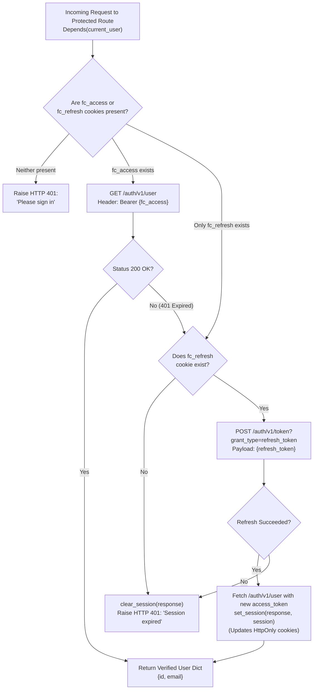
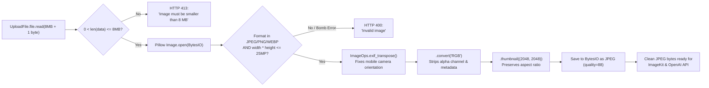
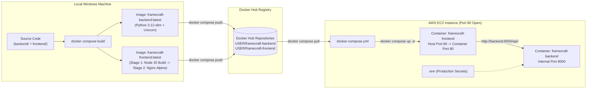

# Framecraft Architecture Defense & Command Guide

This document contains visual flowcharts, deep-dive architectural explanations, bug post-mortems, and every CLI command used to build, debug, containerize, and deploy **Framecraft Studio**.

---

## 1. Visual Flowcharts for Viva Explanation

### A. Authentication & Silent Token Refresh Flow (`auth.py`)
Use this diagram when your mentor asks: *"How does login and session management work without localStorage?"*[cite: 1]



---

### B. Image Validation & Sanitization Pipeline (`media.py`)
Use this diagram when your mentor asks: *"What happens if a user uploads a huge 50MB photo, a rotated phone photo, or a malicious file renamed to `.jpg`?"*[cite: 1]



---

### C. Docker Build & AWS EC2 Deployment Pipeline
Use this diagram when your mentor asks: *"How did you containerize the app and deploy it to AWS EC2?"*



---

## 2. File-by-File Codebase Walkthrough (What Every File Does)

If the mentor asks you to open any file and explain its responsibility, use this breakdown:

| File Path | Core Responsibility & Key Functions |
| :--- | :--- |
| `backend/app/config.py` | Loads `backend/.env` using `load_dotenv(..., override=True)`, strips stray quotes/spaces, defines constants (`DATABASE_URL`, `SUPABASE_URL`, `IMAGE_MODEL`, `MAX_UPLOAD_MB = 8`), and provides `require(*names)` to fail fast with a clear message if any secret is missing[cite: 1]. |
| `backend/app/styles.py` | Defines the `STYLES` dictionary containing the 3 UI presets (`bold`, `minimal`, `vibrant`), their human-readable labels, and the exact prompt engineering instructions injected into OpenAI calls[cite: 1]. |
| `backend/app/schemas.py` | Contains Pydantic v2 models: `Credentials` (validates email/password length), `CreationOptions` (validates prompt, styles, size, quality, format, trims whitespace via `mode='before'`, and blocks duplicate styles), and `CreationResult`/`ImageResult` (`from_attributes=True` for ORM-to-JSON serialization)[cite: 1]. |
| `backend/app/database.py` | Defines SQLAlchemy 2.0 ORM tables `Creation` (`creations`) and `GeneratedImage` (`generated_images`) with a one-to-many relationship (`cascade='all, delete-orphan'`), and `get_db()` generator which lazily initializes the engine and normalizes `postgresql+psycopg://` URLs[cite: 1]. |
| `backend/app/auth.py` | Wraps Supabase Auth REST calls (`supabase()`) using `httpx`, sets/deletes `HttpOnly` cookies (`fc_access` for 1 hr, `fc_refresh` for 30 days), and provides the `current_user` FastAPI dependency with automatic refresh-token rotation[cite: 1]. |
| `backend/app/media.py` | Handles all binary/external media operations: `validate_image()` (Pillow sanitization), `upload_image()` (uploads bytes to `https://upload.imagekit.io/api/v1/files/upload` with HTTP Basic Auth), `build_prompt()` (combines user text with style preset), and `generate_image()` (calls OpenAI `client.images.edit` and decodes `b64_json`)[cite: 1]. |
| `backend/app/main.py` | FastAPI entry point declaring CORS middleware, `RuntimeError` handler, and all 9 REST endpoints (`/api/health`, `/api/styles`, `/api/auth/*`, `/api/creations`)[cite: 1]. |
| `frontend/nginx.conf` | Configures Nginx inside the frontend container to serve React's `dist/` folder, route SPA paths via `try_files $uri $uri/ /index.html`, allow `10M` uploads (`client_max_body_size 10M`), and reverse-proxy `/api/` to `http://backend:8000/api/` with a `190s` timeout. |

---

## 3. High-Probability Mentor Viva Questions & Model Answers

### Q1: Why did we use `VITE_API_BASE_URL=""` (blank) in `.env` when deploying with Docker?
**Answer:**
1. In Vite, environment variables starting with `VITE_` are statically embedded into the JavaScript bundle at **build time** (`npm run build`). If we hardcoded an IP address, the Docker image pushed to Docker Hub would break whenever the EC2 IP changed.
2. More importantly, our backend stores Supabase JWTs in `HttpOnly` cookies with `SameSite=Lax`[cite: 1]. By leaving `VITE_API_BASE_URL` blank, the browser sends requests to relative paths (`/api/...`) on the exact same origin (`http://<EC2_IP>/api/...`). Nginx receives the request on Port 80 and proxies `/api/` internally to `http://backend:8000/api/`. This eliminates cross-origin cookie blocking completely.

---

### Q2: Why does `create_creation` commit the `Creation` row to PostgreSQL *before* calling OpenAI, and why does it catch exceptions inside the `for style in selected.styles:` loop?
**Answer:**
- **Fault Isolation & Audit Trail:** A user can select up to 3 styles (`bold`, `minimal`, `vibrant`) in a single request[cite: 1]. Each style makes a separate paid call to OpenAI's `images.edit` API[cite: 1].
- If we waited until all 3 finished before committing to the database, and the 3rd style failed due to a transient network timeout, the user would lose the first 2 successful images that were already paid for and uploaded to ImageKit.
- Instead, we commit the parent `Creation` first, then loop over each style in its own `try...except` block[cite: 1]. Successful styles are saved with `status='success'` and failed ones with `status='failed'`, ensuring partial progress is never lost[cite: 1].

---

### Q3: How is multi-tenant data isolation enforced so a user cannot view another user's creations?
**Answer:**
- In both `list_creations` (`GET /api/creations`) and `get_creation` (`GET /api/creations/{creation_id}`), the SQL `WHERE` clause explicitly filters by `Creation.user_id == UUID(user['id'])`[cite: 1].
- Because `user['id']` comes directly from `Depends(current_user)`—which verifies the `fc_access` JWT against Supabase Auth server-side—a user cannot spoof another user's ID even if they guess a `creation_id` UUID[cite: 1].

---

### Q4: Why did you use a Multi-Stage Dockerfile for the Frontend?
**Answer:**
- Building a React/Vite project requires Node.js, npm, and hundreds of megabytes of `node_modules` devDependencies. However, once `npm run build` compiles the app into static HTML/CSS/JS inside `/app/dist`, Node.js is no longer needed at runtime.
- Using a **multi-stage build** (`FROM node:20-alpine AS build` followed by `FROM nginx:alpine`), we copy only the compiled `/app/dist` folder into a lightweight Nginx image. This shrinks the final frontend Docker image from ~500 MB down to ~45 MB and removes unnecessary build tools from the production container.

---

### Q5: Why did we use `expose: ["8000"]` instead of `ports: ["8000:8000"]` for the backend service in `docker-compose.yml`?
**Answer:**
- Security best practice (principle of least privilege). `ports: ["8000:8000"]` binds port 8000 to the public EC2 host interface, exposing Uvicorn directly to the internet.
- `expose: ["8000"]` makes port 8000 accessible **only** to other containers inside the private Docker Compose bridge network (specifically, the `frontend` Nginx container via `http://backend:8000`). All external traffic must pass through Nginx on port 80.

---

### Q6: What errors did you encounter during development and how did you resolve them?
**Answer:**
1. **SyntaxError in `styles.py`:** The `STYLES` dictionary was missing its closing brace `}` at the end of the file[cite: 1]; added the closing brace.
2. **OpenAI `401 token_invalidated` Error:**
   - *Cause:* `load_dotenv()` in `config.py` defaults to `override=False`[cite: 1], meaning if an old revoked `OPENAI_API_KEY` existed in the Windows environment, Python ignored the updated `.env` file. Additionally, committing `.env` to Git triggers OpenAI's automatic secret revocation.
   - *Fix:* Enabled `load_dotenv(env_file, override=True)` and `.strip()` in `config.py`, added `.env` to `.gitignore` and `.dockerignore`, and issued a clean API key.
3. **Pydantic Whitespace Prompt Validation (`schemas.py`):**
   - *Cause:* `@field_validator('prompt')` ran in default `after` mode, so `"     "` (5 spaces) passed `Field(min_length=5)` and was then stripped to `""`[cite: 1].
   - *Fix:* Changed the decorator to `@field_validator('prompt', mode='before')` so strings are stripped *before* length validation.
4. **SQLAlchemy Driver Resolution (`database.py`):**
   - *Cause:* Standard `postgresql://` URLs default to `psycopg2`, whereas `requirements.txt` uses `psycopg` (v3)[cite: 1].
   - *Fix:* Added automatic URL prefix normalization (`postgresql+psycopg://`) in `get_db()`.
5. **Supabase Signup Payload Normalization (`main.py`):**
   - *Cause:* When email confirmation is enabled in Supabase, `/auth/v1/signup` returns the user fields at the top level of the JSON response rather than inside `session['user']`, causing `session.get('user')` to return `None`[cite: 1].
   - *Fix:* Updated `signup` to extract `session.get('user') or (session if 'id' in session else None)`.

---

## 4. Complete Command Cheat Sheet (Local, Docker Hub, & EC2)

### A. Local Windows Debugging & Verification Commands
```powershell
# Verify which OpenAI key Python is actually loading from .env
python -c "from app.config import OPENAI_API_KEY; print(OPENAI_API_KEY[:12], '...', OPENAI_API_KEY[-4:])"

# Clear any stuck environment variable in current PowerShell session
Remove-Item Env:\OPENAI_API_KEY -ErrorAction SilentlyContinue

# Run backend locally without Docker (inside backend/ folder)
uvicorn app.main:app --reload --port 8000 --env-file .env
```

### B. Docker Build & Docker Hub Push Commands (On Local Machine)
```powershell
# 1. Authenticate with Docker Hub
docker login

# 2. Build both frontend and backend images defined in docker-compose.yml
docker compose build

# 3. Test containers locally on Port 80 before pushing
docker compose up -d
docker compose ps
docker compose logs -f backend

# 4. Stop local test containers
docker compose down

# 5. Push built images to Docker Hub repositories
docker compose push
```

### C. AWS EC2 Setup & Deployment Commands (On Ubuntu EC2 Server)
```bash
# 1. Install Docker Engine & Docker Compose plugin on Ubuntu EC2
sudo apt-get update
sudo apt-get install -y docker.io docker-compose-v2
sudo systemctl enable --now docker
sudo usermod -aG docker \$USER
newgrp docker

# 2. Create deployment folder and configuration files
mkdir -p ~/framecraft && cd ~/framecraft
nano .env                 # Paste production environment variables
nano docker-compose.yml   # Paste production compose configuration

# 3. Pull latest images from Docker Hub and start in detached mode
docker compose pull
docker compose up -d

# 4. Verify running containers and port mappings
docker compose ps

# 5. Test health check endpoint locally on EC2
curl -i http://localhost/api/health
```

### D. Live Demo Inspection Commands (If Mentor Asks During Viva)
```bash
# Stream real-time FastAPI backend logs while generating a thumbnail
docker compose logs -f backend

# Stream real-time Nginx reverse-proxy logs
docker compose logs -f frontend

# Restart containers and reload .env after changing an API key
docker compose up -d --force-recreate

# Open an interactive shell inside the running backend container
docker exec -it framecraft-backend sh

# Inspect network connectivity between frontend and backend containers
docker network ls
docker compose top
```
